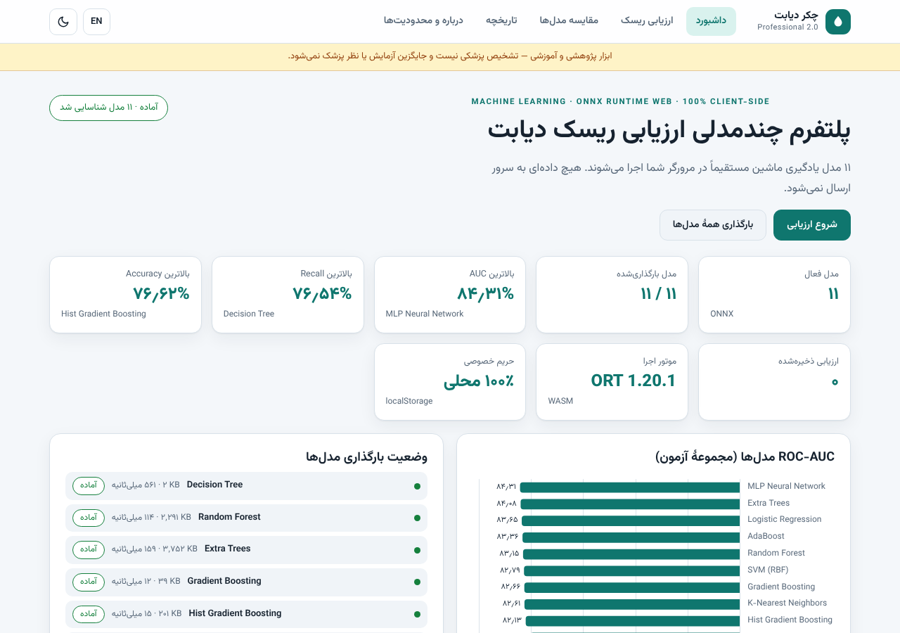
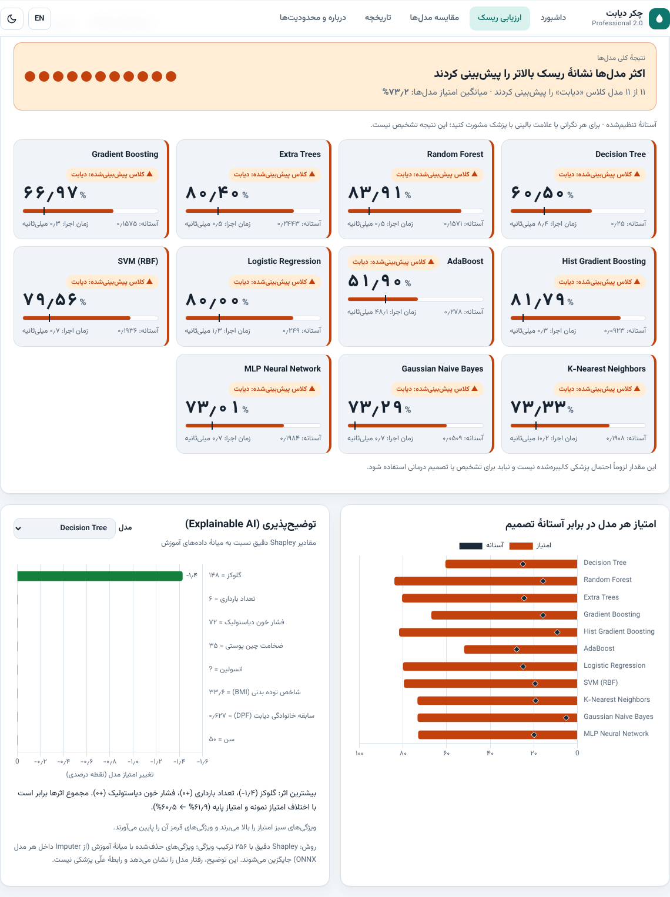
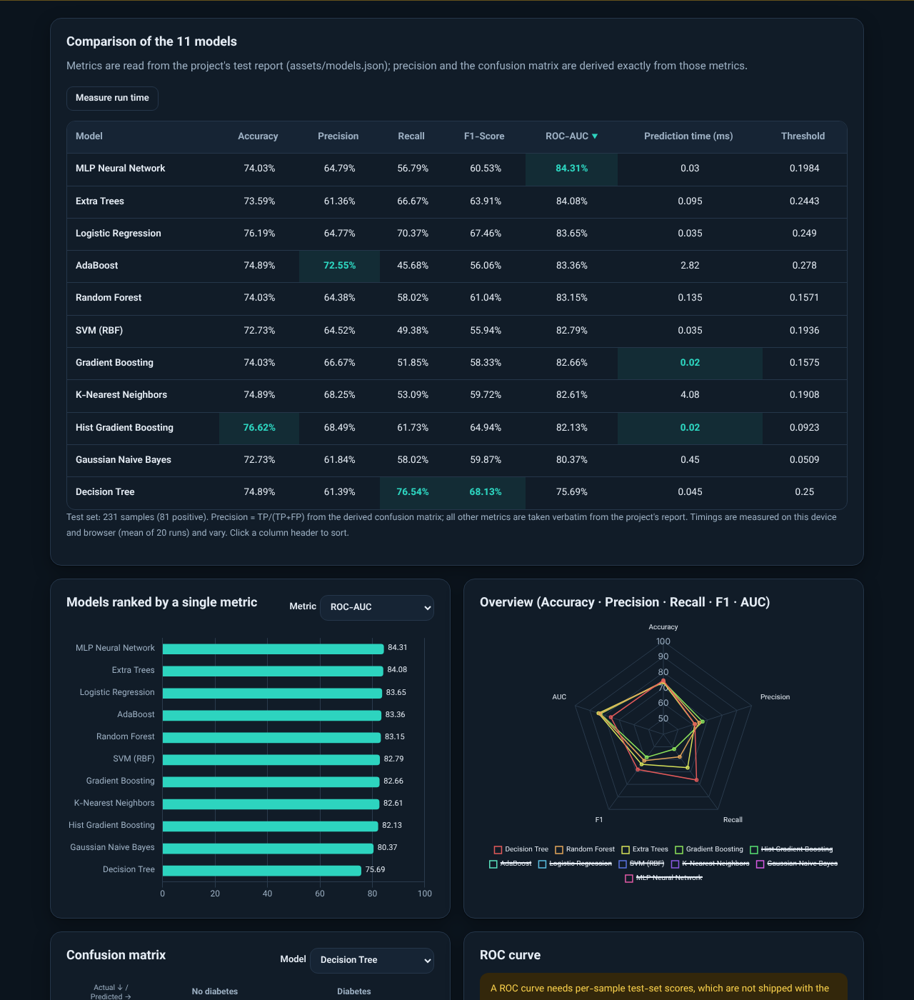
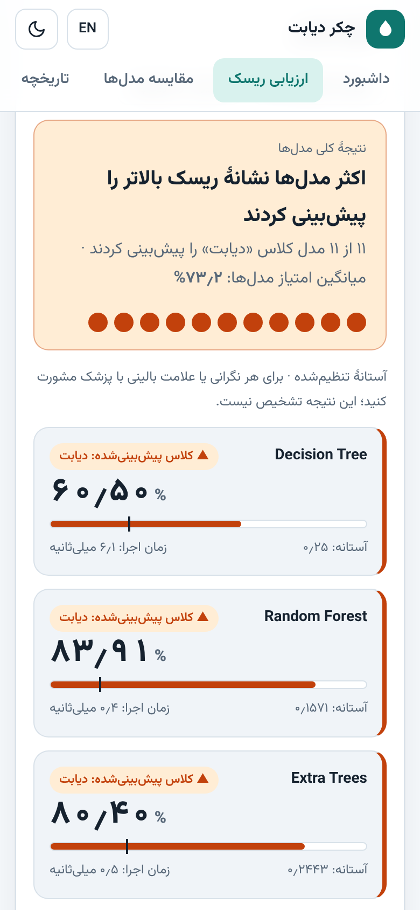

# Diabetes Checker WEB — Professional 2.0

**English** · [فارسی](README_FA.md)

A static, backend-free web platform that runs **11 trained machine-learning models in your browser** (ONNX Runtime Web / WebAssembly) to estimate diabetes risk from eight clinical features, compare the models and explain each prediction.

**Live:** https://as-vanish.github.io/Diabetes-Checker-WEB/

> **Medical warning.** This is a research and education tool. Its output is **not a medical diagnosis**, must not replace laboratory tests or a physician's advice, and a model score is **not necessarily a calibrated clinical probability**. If you have symptoms or concerns, consult a healthcare professional.

| Dashboard (fa, light) | Results (fa, light) |
|---|---|
|  |  |
| **Comparison (en, dark)** | **Mobile (fa)** |
|  |  |

## Features
- Risk assessment form with strict validation (range, integer, required; Persian digits accepted); run all 11 models or one; tuned or fixed 0.5 threshold; consensus verdict; per-model score and run time.
- Model comparison: Accuracy, Precision, Recall, F1, ROC-AUC, confusion matrix, charts, on-device latency benchmark.
- **Explainable AI:** exact Shapley values for every model (see below).
- Local-only history (localStorage) with view / delete / clear and a sensitivity warning.
- PDF report (inputs, results, comparison, charts, explanation, limitations, date/time) generated in the browser.
- Persian (RTL) and English (LTR), switchable without reload; light/dark theme; responsive; reduced-motion aware.
- Lazy model loading with real progress, loaded once, readable errors; fully client-side; self-hosted libraries and fonts (no CDN).

## The 11 models
Decision Tree · Random Forest · Extra Trees · Gradient Boosting · Hist Gradient Boosting · AdaBoost · Logistic Regression · SVM (RBF) · K-Nearest Neighbors · Gaussian Naive Bayes · MLP Neural Network — files in `models/`, unchanged from 1.x.

## Where the numbers come from (no invented data)
- Accuracy, Recall, F1, ROC-AUC and thresholds are read verbatim from `assets/models.json`.
- **Confusion matrices and Precision are derived exactly**: `tools/derive_evaluation.py` searches for the integer matrix (TP, FP, FN, TN) that reproduces the published Accuracy, Recall **and** F1 of every one of the 11 models; the smallest consistent test set is 231 samples (81 positive) and the solution is unique per model. Results: `assets/evaluation.json`; a unit test re-verifies all 33 metric values.
- **ROC curves are not drawn** because per-sample test scores are not in the repository. Only the reported AUC is shown. If you have the test split, `tools/export_evaluation.py` computes real curves.
- **Explainability:** every ONNX pipeline begins with an Imputer holding the training medians. Replacing a feature by NaN therefore means "use the median". For one sample the app evaluates all 2⁸ = 256 feature coalitions in one batch and computes exact Shapley values; they sum to *score(sample) − score(all-median baseline)* (checked in the tests). It describes model behaviour, not medical causality.

## Architecture
```
index.html ── app.js (UI, routing, i18n, state)
                ├─ js/core.js     pure logic: validation, vector building, Shapley, consensus
                ├─ js/engine.js   ONNX Runtime Web: lazy fetch+session cache, predict, benchmark, explain
                ├─ js/charts.js   Chart.js configs (theme/RTL aware)
                ├─ js/report.js   A4 report pages → PDF (html2canvas + jsPDF, lazy-loaded)
                ├─ js/store.js    localStorage history
                └─ i18n/{fa,en}.js
assets/models.json (original) · assets/evaluation.json (derived) · models/*.onnx · vendor/*
```

## Run locally
```bash
python3 -m http.server 8000     # then open http://localhost:8000
```
(Do not open `index.html` via `file://`; ES modules, `fetch` and WASM need HTTP.)

## Deploy on GitHub Pages
1. Push the repository content to `main`.
2. *Settings → Pages → Build and deployment → Deploy from a branch → `main` / `(root)`*.
3. Open `https://<user>.github.io/<repo>/`. All paths are relative and `.nojekyll` is included. No backend or build step is needed.

## Tests
```bash
npm install && npx playwright install chromium
npm test        # unit tests + Chromium end-to-end tests
```
Covers: model/feature-order invariants, validation, Shapley math, derived-metric consistency, i18n key parity, relative paths, **golden comparison of all 11 models in the browser against native onnxruntime** (4 inputs), Shapley efficiency on real models, form/threshold flow, language/RTL and theme switching, comparison view, history, PDF export, no console errors / broken URLs, no horizontal overflow on phones. GitHub Actions runs them on every push (`.github/workflows/test.yml`).

## Technologies
ONNX Runtime Web 1.20.1 (WASM) · Chart.js 4.4.7 · jsPDF 2.5.2 · html2canvas 1.4.1 · Vazirmatn font (OFL) · vanilla ES modules · Node test runner + Playwright.

## Input features
`Pregnancies, Glucose, BloodPressure, SkinThickness, Insulin, BMI, DiabetesPedigreeFunction, Age` (order fixed). In the five columns Glucose, BloodPressure, SkinThickness, Insulin, BMI a value of `0` means *missing* and is imputed by the model.

## Scientific limitations
- Trained and evaluated on one small dataset (Pima Indians, 768 samples); no external validation, bias or calibration analysis.
- Single fixed test set, no confidence intervals — small differences between models are not necessarily meaningful.
- Thresholds were tuned on out-of-fold training predictions.
- Explanations describe the model, not causal relationships.

## File structure
```
├── index.html  app.js  style.css
├── js/  i18n/  assets/ (models.json, evaluation.json, fonts/)  models/  vendor/
├── tools/ (derive_evaluation.py, make_golden.py, export_evaluation.py)
├── tests/ (unit.test.mjs, e2e.test.mjs, golden.json)
├── docs/  .github/workflows/test.yml
└── README.md  README_FA.md  CHANGELOG.md  CONTRIBUTING.md  LICENSE
```

## License
Code: [MIT](LICENSE). Third-party components keep their own licenses (ONNX Runtime Web MIT, Chart.js MIT, jsPDF MIT, html2canvas MIT, Vazirmatn OFL 1.1 — license texts included beside the files). The dataset and any third-party models are subject to their own terms.
