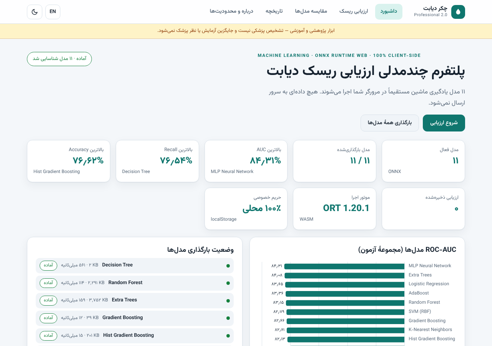
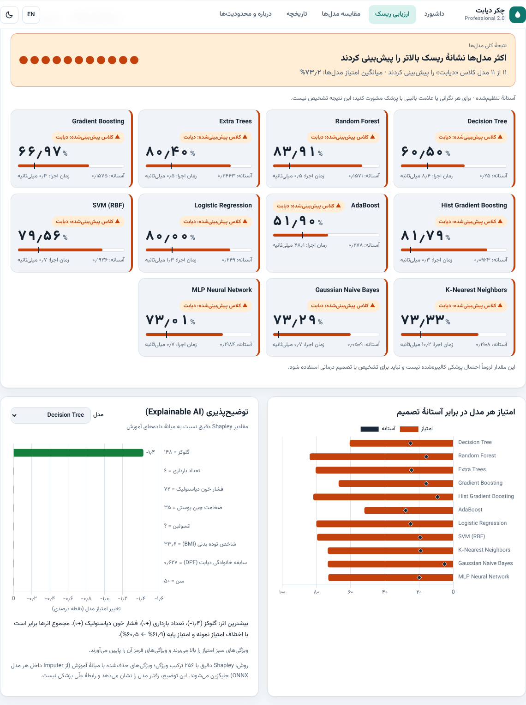
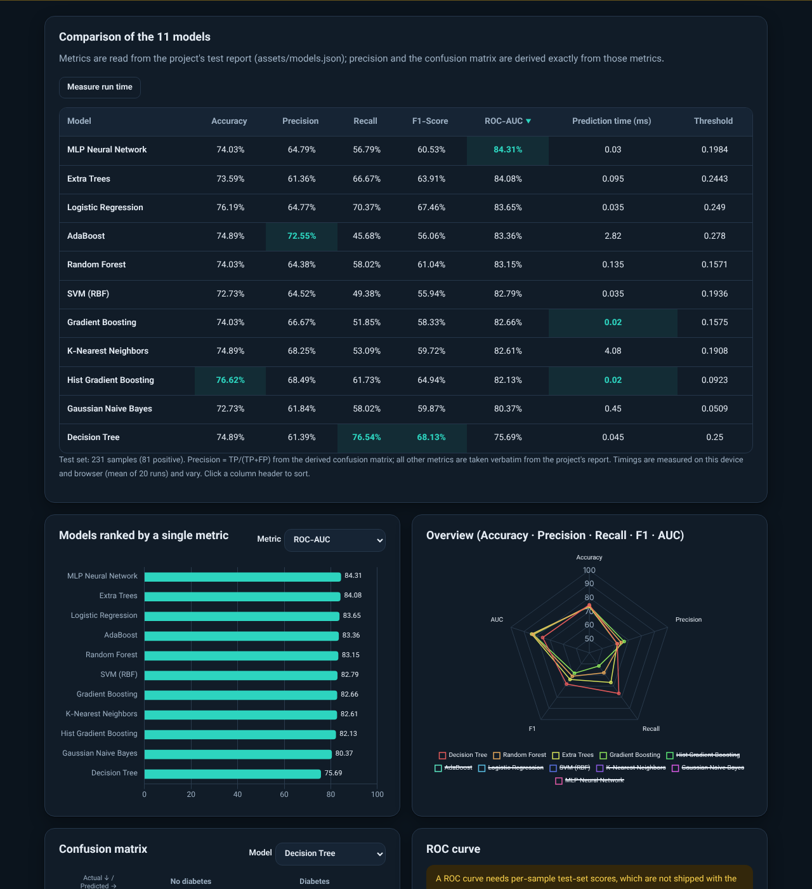
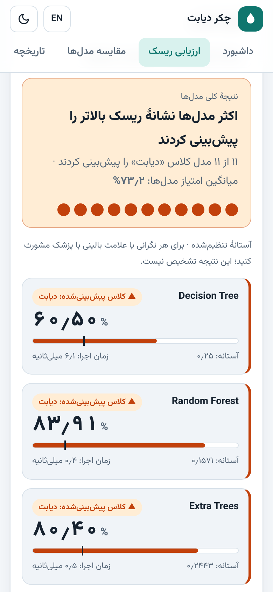

# چکر دیابت (Diabetes Checker WEB) — نسخه حرفه‌ای ۲٫۰

[English](README.md) · **فارسی**

یک پلتفرم وب ایستا و بدون Backend که **۱۱ مدل یادگیری ماشین را مستقیماً در مرورگر** (ONNX Runtime Web / WebAssembly) اجرا می‌کند تا از روی هشت ویژگی بالینی، ریسک دیابت را برآورد کند، مدل‌ها را مقایسه کند و هر پیش‌بینی را توضیح دهد.

**نسخه آنلاین:** https://as-vanish.github.io/Diabetes-Checker-WEB/

> **هشدار پزشکی:** این ابزار صرفاً پژوهشی و آموزشی است. خروجی آن **تشخیص پزشکی نیست**، جایگزین آزمایش یا نظر پزشک نمی‌شود و امتیاز مدل **الزاماً احتمال بالینی کالیبره‌شده نیست**. در صورت علائم یا نگرانی با متخصص سلامت مشورت کنید.

| داشبورد | نتایج |
|---|---|
|  |  |
| **مقایسه (حالت تیره)** | **موبایل** |
|  |  |

## قابلیت‌ها
- فرم ارزیابی با اعتبارسنجی دقیق (بازه، عدد صحیح، الزامی؛ ارقام فارسی پذیرفته می‌شوند)، اجرای ۱۱ مدل یا یک مدل، آستانهٔ تنظیم‌شده یا ثابت ۰٫۵، نتیجهٔ کلی، امتیاز و زمان اجرای هر مدل.
- مقایسهٔ مدل‌ها: Accuracy، Precision، Recall، F1، ROC-AUC، ماتریس درهم‌ریختگی، نمودارها و اندازه‌گیری زمان اجرا روی دستگاه.
- **هوش مصنوعی توضیح‌پذیر** با مقادیر Shapley دقیق برای هر ۱۱ مدل.
- تاریخچهٔ محلی (localStorage) با مشاهده/حذف/پاک‌کردن و هشدار حساسیت اطلاعات.
- گزارش PDF در مرورگر (ورودی‌ها، نتایج، مقایسه، نمودارها، توضیح‌پذیری، محدودیت‌ها، تاریخ و زمان).
- فارسی (RTL) و انگلیسی (LTR) بدون Reload، حالت روشن/تیره، واکنش‌گرا.
- بارگذاری تنبل مدل‌ها با پیشرفت واقعی، بدون بارگذاری تکراری، خطاهای قابل فهم، کاملاً Client-Side و بدون CDN.

## ۱۱ مدل
Decision Tree · Random Forest · Extra Trees · Gradient Boosting · Hist Gradient Boosting · AdaBoost · Logistic Regression · SVM (RBF) · K-Nearest Neighbors · Gaussian Naive Bayes · MLP Neural Network — فایل‌ها در `models/` بدون تغییر نسبت به نسخهٔ ۱ هستند.

## منشأ اعداد (بدون داده ساختگی)
- Accuracy، Recall، F1، ROC-AUC و آستانه‌ها عیناً از `assets/models.json` خوانده می‌شوند.
- **ماتریس درهم‌ریختگی و Precision به‌صورت دقیق مشتق شده‌اند:** `tools/derive_evaluation.py` ماتریس صحیح (TP, FP, FN, TN) را می‌یابد که Accuracy، Recall **و** F1 منتشرشدهٔ هر ۱۱ مدل را هم‌زمان بازتولید کند؛ کوچک‌ترین مجموعهٔ آزمون سازگار ۲۳۱ نمونه (۸۱ مثبت) است و جواب برای هر مدل یکتاست. خروجی: `assets/evaluation.json`؛ یک تست واحد هر ۳۳ مقدار را دوباره بررسی می‌کند.
- **منحنی ROC رسم نمی‌شود**، چون امتیاز تک‌تک نمونه‌های آزمون در مخزن نیست؛ فقط AUC گزارش‌شده نمایش داده می‌شود. اگر داده آزمون را دارید، `tools/export_evaluation.py` منحنی واقعی می‌سازد.
- **توضیح‌پذیری:** هر pipeline مدل با یک Imputer (میانهٔ داده آموزش) شروع می‌شود؛ پس جایگزینی یک ویژگی با NaN یعنی «استفاده از میانه». برنامه برای یک نمونه هر ۲⁸ = ۲۵۶ ترکیب ویژگی را یک‌جا اجرا و Shapley دقیق را محاسبه می‌کند؛ مجموع اثرها برابر است با *امتیاز نمونه − امتیاز پایه* (در تست‌ها بررسی می‌شود). این توضیح رفتار مدل را نشان می‌دهد، نه علت پزشکی.

## معماری
```
index.html ── app.js (رابط، مسیریابی، ترجمه، وضعیت)
                ├─ js/core.js     منطق خالص: اعتبارسنجی، ساخت بردار، Shapley، نتیجهٔ کلی
                ├─ js/engine.js   ONNX Runtime Web: بارگذاری تنبل + کش نشست، پیش‌بینی، بنچمارک، توضیح
                ├─ js/charts.js   نمودارهای Chart.js (سازگار با تم و RTL)
                ├─ js/report.js   صفحات A4 گزارش ← PDF
                ├─ js/store.js    تاریخچه در localStorage
                └─ i18n/{fa,en}.js
```

## اجرای محلی
```bash
python3 -m http.server 8000     # سپس http://localhost:8000
```
(`index.html` را با `file://` باز نکنید.)

## تست‌ها
```bash
npm install && npx playwright install chromium
npm test
```
شامل: ثابت‌های مدل/ترتیب ویژگی‌ها، اعتبارسنجی، ریاضی Shapley، سازگاری معیارهای مشتق‌شده، یکسان‌بودن کلیدهای ترجمه، مسیرهای نسبی، **مقایسهٔ خروجی هر ۱۱ مدل در مرورگر با onnxruntime بومی (۴ ورودی)**، تغییر زبان/RTL و تم، مقایسه، تاریخچه، خروجی PDF، نبود خطای کنسول و مسیر خراب، و نبود اسکرول افقی در موبایل. GitHub Actions آن‌ها را روی هر push اجرا می‌کند.

## فناوری‌ها
ONNX Runtime Web 1.20.1 · Chart.js 4.4.7 · jsPDF 2.5.2 · html2canvas 1.4.1 · فونت Vazirmatn (OFL) · ES Modules · Node test + Playwright.

## ویژگی‌های ورودی
`Pregnancies, Glucose, BloodPressure, SkinThickness, Insulin, BMI, DiabetesPedigreeFunction, Age` (ترتیب ثابت). در پنج ستون Glucose، BloodPressure، SkinThickness، Insulin و BMI مقدار `0` یعنی «نامشخص» و توسط مدل با میانه جایگزین می‌شود.

## محدودیت‌های علمی
- آموزش و ارزیابی روی یک مجموعه‌دادهٔ کوچک (Pima، ۷۶۸ نمونه)؛ بدون اعتبارسنجی بیرونی، تحلیل سوگیری یا کالیبراسیون.
- یک مجموعهٔ آزمون ثابت و بدون فاصلهٔ اطمینان؛ تفاوت‌های کوچک بین مدل‌ها لزوماً معنادار نیست.
- آستانه‌ها روی پیش‌بینی‌های out-of-fold آموزش تنظیم شده‌اند.
- توضیح‌ها رفتار مدل را نشان می‌دهند و علّی نیستند.

## مجوز
کد: [MIT](LICENSE). اجزای شخص ثالث مجوز خود را دارند (ONNX Runtime Web، Chart.js، jsPDF، html2canvas: MIT؛ Vazirmatn: OFL 1.1؛ متن مجوزها کنار فایل‌ها آمده است). مجموعه‌داده و مدل‌های شخص ثالث تابع شرایط خودشان هستند.
